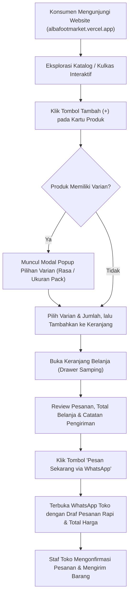
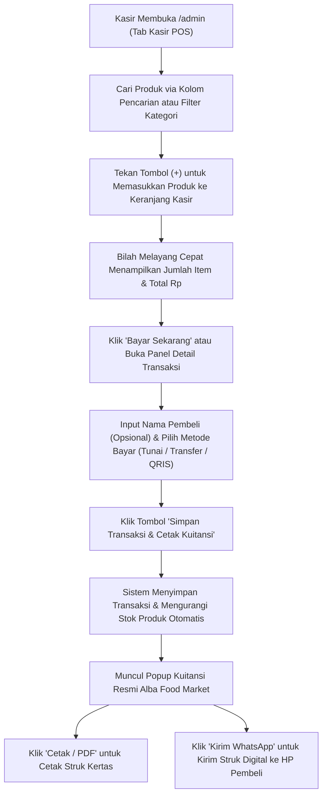
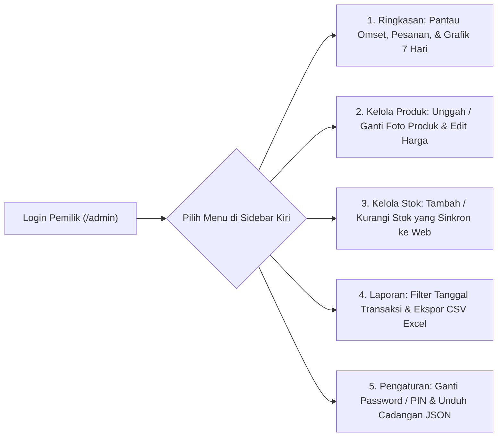

# DOKUMEN PRESENTASI & PROPOSAL PENGEMBANGAN WEBSITE ALBA FOOD MARKET
**Sistem Terintegrasi: Web E-Commerce Pelanggan + Kasir POS + Dashboard Manajemen Pemilik Toko**

---

## 1. Ringkasan Eksekutif (Executive Summary)

Website **Alba Food Market** dirancang dan dibangun sebagai **solusi perdagangan modern serba-ada (*All-in-One Retail & E-Commerce Platform*)** yang secara spesifik menjembatani transaksi belanja online pelanggan dan operasional harian toko fisik (Sawangan, Depok).

Berbeda dari website toko online biasa yang hanya berfungsi sebagai "brosur digital", platform ini merupakan **Sistem Operasi Bisnis Toko (*Store Business Operating System*)** mandiri yang menyatukan:
1. **Etalase Belanja Konsumen (Front-Office)**: Katalog produk interaktif, kulkas interaktif, modal pemilihan varian rasa/ukuran, dan pemesanan instan terhubung langsung ke WhatsApp Toko tanpa potongan komisi pihak ketiga (*zero marketplace fees*).
2. **Terminal Kasir Toko Fisik (Point of Sale / POS)**: Antarmuka kasir cepat untuk melayani transaksi langsung di toko fisik, mendukung metode pembayaran Tunai, Transfer Bank, dan QRIS, serta mencetak kuitansi nota kasir resmi maupun mengirimkannya via WhatsApp pelanggan.
3. **Dashboard Pemilik Toko (Back-Office Management)**: Portal terisolasi dengan sidebar navigasi vertikal di sebelah kiri, grafik tren penjualan 7 hari, peringkat produk terlaris, manajemen foto produk langsung dari kamera HP/laptop, kontrol stok real-time, dan ekspor laporan keuangan ke format CSV/Excel.

---

## 2. Pihak Pengguna & Sasaran Penggunaan (User Personas & Use Cases)

| Peran Pengguna | Lingkungan Akses | Kebutuhan Utama | Nilai Manfaat yang Diberikan |
| :--- | :--- | :--- | :--- |
| **Konsumen / Pembeli Online** | Smartphone & Laptop (Publik) | Mencari produk beku (sambosa, roti canai, kurma), memilih varian rasa/pack, mengetahui alamat & jam buka toko, order cepat via WA. | Tampilan cepat tanpa unduh aplikasi, navigasi interaktif, kalkulasi keranjang otomatis, dan pemesanan WA transparan. |
| **Kasir / Staf Toko** | Tablet / HP Kasir / PC Kasir | Mencatat transaksi pembeli di tempat, input pesanan cepat, cek stok tersisa, dan cetak bukti kuitansi belanja. | Pencarian produk instan, stepper kuantitas mudah disentuh, otomatis potong stok, dan cetak kuitansi PDF/kertas kasir. |
| **Pemilik Toko (Merchant Owner)** | Layar Laptop / Smartphone Pemilik | Memantau omset harian, melihat produk paling laku, ganti foto produk toko, restock barang, unduh laporan penjualan. | Kontrol penuh bisnis 24/7, privasi login ber-password/PIN, data tersimpan aman, dan analisa grafik omzet harian. |

---

## 3. Alur Kerja Sistem (End-to-End System Workflows)

### 3.1 Alur Belanja Konsumen Online (Customer Ordering Journey)



---

### 3.2 Alur Transaksi Kasir Toko Fisik (Point of Sale / POS Workflow)



---

### 3.3 Alur Manajemen Pemilik Toko (Merchant Owner Operations)



---

## 4. Matriks Fitur Lengkap yang Telah Selesai Dibangun

### A. Sisi Publik Toko (E-Commerce Storefront)
1. **Beranda Interaktif**:
   - Hero banner pencarian produk berukuran besar.
   - **Showcase Kulkas Interaktif**: Visualisasi rak kulkas penyimpanan produk beku (*frozen food*) yang dapat diklik.
   - **Banner Unggulan Dinamis**: Carousel produk andalan (Sambosa Daging, Kebab Daging, Roti Canai, Onde-onde) lengkap dengan sorotan rasa dan tombol beli instan.
   - **Kartu Informasi Toko**: Jam operasional dengan indikator live (*"Buka"* / *"Tutup · Buka besok 09.00"*), alamat Depok lengkap, tautan Google Maps, serta badge layanan dan metode pembayaran.
2. **Katalog Produk & Varian**:
   - Filter cepat berdasarkan kategori (Sambosa, Olahan Daging, Roti Canai, Kurma, Bumbu, dll).
   - **Modal Pemilih Varian Pop-up**: Muncul otomatis saat tombol tambah diklik untuk produk dengan varian rasa/ukuran (contoh: Daging Sapi, Ayam Pedas, Keju Mozzarella).
   - Indikator ketersediaan stok produk dan jumlah produk yang telah terjual.
3. **Sistem Keranjang Belanja (*Slide-over Cart Drawer*)**:
   - Header keranjang tetap (*sticky header*) saat daftar barang belanjaan panjang.
   - Stepper jumlah barang yang responsif dengan validasi batas stok toko.
   - Tombol satu-klik untuk langsung terhubung ke WhatsApp resmi dengan format pemesanan otomatis.
4. **Navigasi Mobile Responsif**:
   - Tabbar bawah (*bottom navigation bar*) untuk kemudahan akses satu jempol (Beranda, Produk, Lokasi, Keranjang Belanja, WhatsApp).

### B. Sisi Dashboard Admin & Kasir (Merchant Back-Office)
1. **Tata Letak Dashboard Profesional**:
   - **Sidebar Vertikal Sebelah Kiri**: Menu navigasi tertata vertikal dengan avatar toko, status online, badge notifikasi, serta footer aksi cepat ke website toko.
   - **Mode Standalone Terisolasi**: Halaman dashboard bersih dari navbar dan footer toko biasa untuk konsentrasi kerja penuh.
   - **Mobile Drawer Navigasi**: Tombol hamburger merah yang mudah dijangkau di layar smartphone untuk membuka menu samping.
2. **Ringkasan Eksekutif & Analitik (Overview Tab)**:
   - 4 Kartu KPI Utama: Total Omset, Total Transaksi, Total Pack Terjual, dan Status Stok Menipis.
   - **Grafik Batang Penjualan 7 Hari Terakhir**: Memetakan tren omset harian toko secara otomatis dengan hari aktif berwarna hijau zamrud.
   - **Leaderboard Produk Paling Laris**: Peringkat penjualan produk dengan medali emas, perak, dan perunggu.
   - **Distribusi Pembayaran**: Rekap transaksi via Tunai, Transfer Bank, dan QRIS.
3. **Kasir POS (*Point of Sale*) & Generator Kuitansi**:
   - Antarmuka kasir cepat dengan foto produk mini dan stepper kuantitas 34px.
   - **Floating Mobile Checkout Bar**: Bilah mengambang di layar HP kasir untuk langsung melompat ke form pembayaran tanpa repot menggulir layar.
   - Cetak struk kuitansi kasir dengan format thermal 80mm dan tombol langsung bagikan kuitansi via WhatsApp pembeli.
4. **Kelola Produk & Penggantian Foto (Product Manager)**:
   - Fitur unggah foto langsung dari kamera HP atau komputer.
   - **Kompresi Foto Otomatis**: Foto dikompresi di sisi browser menjadi format WebP berkualitas tinggi dengan bobot ringan di bawah 150 KB untuk menghemat kuota internet dan mempercepat loading.
   - Edit nama, varian rasa, ukuran kemasan, harga normal, harga grosir/reseller, dan status unggulan.
5. **Manajemen Stok Real-time**:
   - Banner peringatan dini ketika ada barang yang stoknya menipis (di bawah 5 pack).
   - Tombol stepper cepat `[ − ] [ Angka ] [ + ]` yang langsung memperbarui sisa stok di seluruh kartu produk website.
6. **Laporan Penjualan & Ekspor CSV**:
   - Rekap omzet harian dengan pemilih tanggal kalender.
   - Tombol **Ekspor CSV** satu-klik yang dapat langsung dibuka di Microsoft Excel atau Google Sheets untuk pencatatan akuntansi toko.
7. **Keamanan & Pencadangan Data (Settings)**:
   - Fitur ganti password / PIN pemilik toko.
   - Tombol **Unduh Backup JSON** untuk menyimpan seluruh arsip transaksi dan stok secara lokal kapan pun dibutuhkan.

---

## 5. Nilai Tambah & Keunggulan Kompetitif (Value Proposition)

| Keunggulan | Website Alba Food Market | Website Toko Online Biasa / Template Murahan |
| :--- | :--- | :--- |
| **Biaya Bulanan Database** | **Rp 0,- (Gratis Selamanya)** karena menggunakan arsitektur modern Local-First Storage. | Rp 200.000 - Rp 500.000 / bulan untuk sewa database SQL / Firebase. |
| **Kecepatan Akses** | **Maksimal (Skor 95-100 Google Lighthouse)** dibangun dengan Next.js 15 App Router & Static Site Generation. | Sering lambat (> 4 detik) karena memuat plugin CMS yang berat. |
| **Komisi Marketplace** | **0% Tanpa Potongan**. Penjualan via WA dan kasir masuk 100% ke rekening toko. | Terpotong 5% - 10% setiap transaksi oleh marketplace online. |
| **Kasir & Kuitansi** | **Sudah Termasuk Kasir POS**. Cetak nota struk dan bagikan struk via WA langsung tersedia. | Harus berlangganan aplikasi POS kasir terpisah (Rp 150.000/bln). |
| **Akses di Layar HP** | **Penuh Responsif Mobile-First**. Nyaman dijalankan kasir dan pemilik toko langsung dari browser smartphone. | Tampilan admin di HP sering rusak, tulisan bertumpuk, dan tombol terlalu kecil. |

---

## 6. Rekomendasi Paket Harga & Pencocokan Biaya (Commercial Pricing Proposals)

Berikut adalah panduan struktur penawaran harga (*rate card*) yang dapat Anda gunakan saat mempresentasikan hasil rancangan ini kepada customer/klien:

### Pilihan Opsi Paket Penawaran

```
+-----------------------------------------------------------------------------------+
|  PAKET 1: STANDARD E-COMMERCE STOREFRONT (Rp 4.500.000 - Rp 6.000.000)            |
|  Cocok untuk: Toko yang hanya membutuhkan etalase online & order WhatsApp         |
|  - Desain responsif mobile & desktop                                              |
|  - Katalog produk lengkap & modal pilihan varian                                  |
|  - Keranjang belanja drawer terintegrasi WhatsApp                                 |
|  - Banner unggulan carousel & kartu info jam buka toko live                       |
|  - Setup domain & hosting di cloud Vercel                                         |
+-----------------------------------------------------------------------------------+
|  PAKET 2: PROFESSIONAL BUSINESS + KASIR POS (Rp 7.500.000 - Rp 9.500.000)         |
|  Cocok untuk: Toko fisik yang melayani pembeli langsung & online harian           |
|  - Semua fitur Paket 1                                                            |
|  + Sistem Kasir Toko Fisik (POS Terminal) di tablet / laptop                      |
|  + Generator kuitansi belanja (Cetak Thermal / PDF / Kirim Struk WA)              |
|  + Kelola stok barang real-time (otomatis potong stok saat kasir input)           |
|  + Laporan penjualan harian & fitur Ekspor CSV Excel                              |
|  + Sistem keamanan login password/PIN pemilik toko                                |
+-----------------------------------------------------------------------------------+
|  PAKET 3: ENTERPRISE COMPLETE RETAIL ECOSYSTEM (Rp 12.000.000 - Rp 15.000.000)    |
|  (RANCANGAN SAAT INI YANG TELAH KITA BANGUN LENGKAP)                              |
|  Cocok untuk: Solusi all-in-one tanpa biaya bulanan aplikasi pihak ketiga         |
|  - Semua fitur Paket 1 & Paket 2                                                  |
|  + Standalone Executive Merchant Dashboard dengan Sidebar Navigasi Vertikal       |
|  + Grafik Tren Penjualan 7 Hari Otomatis & Leaderboard Produk Paling Laris        |
|  + Modul Pengelola Foto Produk (Upload langsung kamera HP + Kompresi WebP)        |
|  + Floating Mobile Checkout Bar untuk kasir HP super cepat                        |
|  + Modul Cadangan Data (JSON Full Backup System)                                  |
|  + Optimasi SEO Google Schema.org untuk pencarian lokal Sawangan Depok            |
|  + Garansi bug & pelatihan penggunaan sistem hingga mahir                         |
+-----------------------------------------------------------------------------------+
```

---

### Rincian Anggaran Biaya (RAB) Rancangan Lengkap (Paket 3 - Recommended)

| Komponen Pekerjaan | Deskripsi Teknis | Nilai Wajar Pasar | Nilai Penawaran Anda |
| :--- | :--- | :--- | :--- |
| **Arsitektur Front-End & UI/UX** | Next.js 15, React 19, CSS Modern, Mobile-First Layout, Animasi Interaktif | Rp 3.500.000 | Rp 3.000.000 |
| **Sistem Keranjang & Integrasi WA** | Cart Drawer, Multi-Variant Modal, WhatsApp API Template Link Builder | Rp 2.000.000 | Rp 1.500.000 |
| **Terminal Kasir POS & Kuitansi** | POS Multi-metode pembayaran, auto-stock decrement, cetak nota thermal 80mm & WA | Rp 3.000.000 | Rp 2.500.000 |
| **Dashboard Analytics & Sidebar** | Left-side Vertical Sidebar, Drawer Mobile, Grafik 7 Hari, Metrik Finansial | Rp 3.500.000 | Rp 2.500.000 |
| **Modul Foto & Kompresi WebP** | Upload foto client-side, resize & compress lossless WebP, live store sync | Rp 2.500.000 | Rp 2.000.000 |
| **Laporan & Ekspor CSV** | Rekap omset, filtering rentang tanggal, pembuat berkas CSV Excel | Rp 1.500.000 | Rp 1.000.000 |
| **Setup Cloud & Domain Deployment**| Vercel Cloud Server, SSL HTTPS, Google Local Business Schema Metadata | Rp 1.500.000 | Rp 1.000.000 |
| **TOTAL NILAI ESTIMASI** | **Platform Komersial Siap Pakai** | **Rp 17.000.000** | **Rp 13.500.000** *(Bisa dinegosiasikan)* |

> [!TIP]
> **Strategi Negosiasi dengan Klien**:
> Jika customer meminta diskon harga, tawarkan harga **Rp 9.500.000 - Rp 11.500.000** untuk pelunasan cepat atau paket bundling dengan biaya pemeliharaan (*maintenance bulanan* Rp 250.000 - Rp 500.000/bulan) untuk update menu dan banner promosi berkala.

---

## 7. Panduan Langkah Presentasi ke Customer (Pitching Guide)

Saat mempresentasikan sistem ini ke klien/pemilik toko, ikuti 4 babak presentasi berikut:

### Babak 1: Tunjukkan Solusi untuk Pembeli Online (Front-Store)
1. **Buka halaman Beranda** di laptop atau HP.
2. Tunjukkan **Kulkas Interaktif** dan **Banner Produk Unggulan**: Jelaskan bahwa foto produk tampil menggugah selera dan profesional.
3. Klik tombol **Tambah (+)** pada salah satu produk: Perlihatkan **Modal Pilihan Varian** (misal: pilihan rasa daging / keju).
4. Buka **Keranjang Belanja Drawer**, lalu tekan tombol **Pesan via WhatsApp**.
5. *Poin Bicara ke Klien*: *"Pelanggan ibu tidak perlu repot mengetik ulang nama produk dan alamat. Begitu klik pesan di web, di WhatsApp toko langsung masuk daftar rincian barang beserta total rupiahnya dengan rapi."*

### Babak 2: Tunjukkan Kemudahan Kasir Toko Fisik (POS Terminal)
1. Buka route **/admin** dan langsung pilih tab **Kasir POS**.
2. Simulasikan ada pembeli datang ke toko:
   - Ketik nama produk di kolom pencarian atau klik kategori.
   - Tekan tombol `+` pada 2-3 barang.
   - Tunjukkan **Floating Bar** di bawah layar HP: *"3 item · Rp 75.000"*.
   - Tekan **Bayar Sekarang**, pilih metode **QRIS**, lalu tekan **Simpan Transaksi**.
3. Seketika muncul **Kuitansi Resmi Alba Food Market**:
   - Tunjukkan tombol **Cetak Struk** dan tombol **Kirim WhatsApp**.
4. *Poin Bicara ke Klien*: *"Ibu tidak perlu sewa mesin kasir mahal atau aplikasi kasir bulanan. Cukup pakai HP atau tablet toko, kasir langsung bisa melayani pembeli dan stok otomatis terpotong."*

### Babak 3: Tunjukkan Kontrol Penuh Pemilik Toko (Merchant Dashboard)
1. Ajak klien melihat **Sidebar Sebelah Kiri**: Tunjukkan betapa teraturnya menu navigasi di sisi kiri seperti software bisnis modern.
2. Buka tab **Ringkasan**: Tunjukkan kartu Omset, Pesanan, Barang Terjual, dan **Grafik Penjualan 7 Hari**.
3. Buka tab **Kelola Produk & Foto**:
   - Tunjukkan tombol **Ganti Foto**. Tunjukkan bahwa foto dari HP bisa langsung di-upload dan otomatis terkompresi ringan tanpa membuat website lemot.
4. Buka tab **Kelola Stok**:
   - Ubah angka stok suatu barang, lalu buka website di tab lain untuk membuktikan stok langsung berubah seketika (*real-time sync*).
5. Buka tab **Laporan Penjualan**:
   - Klik **Ekspor CSV**: Tunjukkan bahwa dalam 1 detik, laporan transaksi sudah terunduh dalam format Excel yang siap diserahkan ke pencatatan pembukuan.

### Babak 4: Penutupan & Pencocokan Harga (Closing the Deal)
- Tekankan bahwa sistem ini dibangun **khusus (*custom-tailored*)** untuk Alba Food Market, bukan template bajakan.
- Tekankan bahwa platform ini **tanpa biaya langganan bulanan server database**, sehingga menghemat jutaan rupiah setiap tahunnya bagi toko klien.
- Ajukan paket penawaran harga sesuai kesepakatan target anggaran klien.

---

*Dokumen ini disusun sebagai aset resmi presentasi komersial proyek pengembangan platform digital Alba Food Market.*
