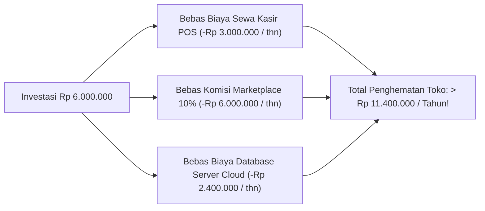

# SURAT PENAWARAN & RINCIAN DETAIL PENGEMBANGAN SISTEM
**ALBA FOOD MARKET: PLATFORM E-COMMERCE + KASIR POS + DASHBOARD EKSEKUTIF**

---

**Nomor Dokumen**: 001/SP-AFM/XI/2026  
**Tanggal**: 17 November 2026  
**Kepada Yth**: Pemilik & Manajemen Alba Food Market  
**Lokasi**: Sawangan, Kota Depok, Jawa Barat  
**Perihal**: Rincian Investasi & Spesifikasi Sistem Digital Terintegrasi  

---

## 1. Latar Belakang & Nilai Strategis Investasi

Alba Food Market memiliki potensi besar dalam perdagangan makanan beku (*frozen food*) berkualitas di wilayah Depok dan sekitarnya. Untuk meningkatkan omzet tanpa terbebani potongan komisi marketplace (5% – 20%) serta menghindari biaya sewa aplikasi kasir bulanan, kami merancang **Sistem Digital Terpadu Mandiri** dengan model beli putus (*one-time investment*).

Dengan harga penawaran promo **Rp 6.000.000,- (Enam Juta Rupiah Nett)**, Alba Food Market memperoleh platform komersial tingkat tinggi setara enterprise yang siap pakai.

---

## 2. Rincian Anggaran Biaya (RAB) Komponen Sistem

Tabel di bawah ini membandingkan nilai komersial wajar di pasar agensi digital dengan nilai paket penawaran khusus yang kami berikan:

| No | Modul & Komponen Pekerjaan | Spesifikasi & Deliverables | Nilai Pasar Wajar | Nilai Paket Khusus |
| :---: | :--- | :--- | :---: | :---: |
| **1** | **Arsitektur Front-End & UI/UX E-Commerce** | - Framework modern Next.js 15 App Router & React 19.<br>- 100% Responsif di Layar HP, Tablet, & Komputer.<br>- Desain eksklusif bertema hangat (Cream & Merah Brand).<br>- Showcase Kulkas Interaktif (*Interactive Fridge*).<br>- Banner Produk Unggulan Dinamis dengan Carousel slider.<br>- Kartu Info Toko Jam Buka Live Badge & Integrasi Google Maps. | Rp 3.500.000 | **Rp 1.400.000** |
| **2** | **Katalog Produk, Varian, & Keranjang WA** | - Modal Pop-up Pilihan Varian (Rasa & Ukuran Pack).<br>- Slide-over Cart Drawer dengan header sticky.<br>- Validasi batas stok otomatis pada keranjang.<br>- Integrasi Otomatis WhatsApp Order Builder (Format teks pesanan rapi beserta kalkulasi total rupiah). | Rp 2.200.000 | **Rp 1.100.000** |
| **3** | **Sistem Kasir Toko Fisik (POS Terminal)** | - Antarmuka kasir cepat pencarian nama & filter kategori.<br>- Stepper tombol sentuh kuantitas (diameter 34px-36px).<br>- Bilah Melayang (*Floating Checkout Bar*) khusus layar HP.<br>- Pilihan metode pembayaran: Tunai, Transfer Bank, QRIS.<br>- Generator Kuitansi Nota Kasir Otomatis (Format thermal 80mm).<br>- Tombol cetak printer kasir & bagikan kuitansi via WA. | Rp 2.800.000 | **Rp 1.300.000** |
| **4** | **Dashboard Analitik & Sidebar Mandiri** | - Tata letak standalone (terisolasi dari web konsumen).<br>- Sidebar navigasi vertikal kiri + Drawer drawer mobile.<br>- 4 Kartu KPI Finansial: Omset, Pesanan, Terjual, Low Stock.<br>- Grafik Batang Penjualan 7 Hari Terakhir otomatis.<br>- Leaderboard Produk Paling Laris (Medali #1, #2, #3).<br>- Distribusi persentase metode pembayaran (Tunai/TF/QRIS). | Rp 2.500.000 | **Rp 1.000.000** |
| **5** | **Manajemen Foto Produk & Stok Real-Time** | - Upload foto produk langsung dari kamera HP/laptop.<br>- Mesin kompresi WebP client-side otomatis (< 150 KB).<br>- Edit varian rasa, harga ecer, harga grosir, status unggulan.<br>- Banner peringatan otomatis jika stok < 5 pack.<br>- Tombol penyesuaian stok instan yang sinkron ke web belanja. | Rp 1.800.000 | **Rp 700.000** |
| **6** | **Pelaporan Keuangan & Infrastruktur Cloud** | - Filter tanggal laporan penjualan harian.<br>- Tombol Ekspor CSV/Excel satu kali klik.<br>- Modul keamanan PIN/Password pemilik & Cadangan JSON.<br>- Setup Cloud Vercel Server, Keamanan SSL HTTPS.<br>- Schema.org Google Search Local Business SEO Depok. | Rp 1.500.000 | **Rp 500.000** |
| **TOTAL** | **NILAI INVESTASI PENUH** | **Platform Komersial Lengkap Siap Pakai** | **Rp 14.300.000** | **Rp 6.000.000** |

> [!NOTE]  
> **Klien Menghemat Rp 8.300.000 (Diskon ~58%)** dari nilai wajar pasar untuk pembuatan sistem kustom terintegrasi.

---

## 3. Rincian Manfaat Ekonomis & Balik Modal (ROI Analysis)

Investasi Rp 6.000.000 ini dirancang agar kembali modal (*break-even*) dalam waktu sangat singkat melalui efisiensi berikut:



1. **Hemat Biaya Sewa Aplikasi Kasir Bulanan**:  
   Aplikasi kasir seperti Moka POS atau Pawoon mengenakan biaya Rp 250.000/bulan = **Rp 3.000.000/tahun**. Sistem ini sudah memiliki kasir built-in tanpa bayar langganan selamanya.
2. **Hemat Biaya Komisi Marketplace**:  
   Penjualan online via marketplace memotong 5% – 15% komisi. Dengan rata-rata omzet online Rp 5.000.000/bulan, toko menghemat potongan komisi sebesar **Rp 300.000 – Rp 500.000/bulan (Rp 3,6 – 6 Juta/tahun)**.
3. **Waktu Balik Modal (*Payback Period*)**:  
   Hanya dalam **4 hingga 7 bulan**, sistem ini sudah sepenuhnya terbayar dari penghematan biaya operasional toko.

---

## 4. Ketentuan Garansi, Pelatihan, & Layanan Pasca-Serah Terima

Dalam paket Rp 6.000.000 ini sudah mencakup jaminan keamanan dan kenyamanan toko:
* **Garansi Bug / Error Teknis**: 3 bulan masa garansi penuh perbaikan jika ditemukan kendala pada sistem.
* **Pelatihan Penggunaan Sistem (*Training*)**: 1 sesi pendampingan operasional untuk kasir dan pemilik toko hingga dapat melayani transaksi dan mengelola stok secara mandiri.
* **Panduan Pengoperasian (*User Manual*)**: Dokumen petunjuk singkat cara ganti foto, ubah harga, input kasir, dan download laporan Excel.
* **Opsi Perpanjangan Tahun Berikutnya (Opsional)**: Biaya sewa domain kustom (.com/.id) dan pemeliharaan teknis ringan sebesar **Rp 350.000 – Rp 500.000 per tahun** (mulai dibayarkan pada tahun ke-2).

---

## 5. Tahapan Pembayaran & Skema Kerja Sama

Untuk menjaga transparansi dan rasa aman bagi kedua belah pihak, skema pembayaran dibagi menjadi 2 tahap:

```
+--------------------------------------------------------------------------------+
|  TAHAP 1: UANG MUKA (DP 50%) = Rp 3.000.000,-                                 |
|  - Dibayarkan saat surat penawaran disetujui.                                  |
|  - Digunakan untuk alokasi domain, finalisasi akun merchant, dan setup cloud. |
+--------------------------------------------------------------------------------+
|  TAHAP 2: PELUNASAN (50%) = Rp 3.000.000,-                                    |
|  - Dibayarkan setelah sesi presentasi demo sistem dan serah terima hak akses.  |
|  - Penyerahan password admin, akun dashboard pemilik, dan pelatihan staf.     |
+--------------------------------------------------------------------------------+
```

---

## 6. Template Pesan / Surat Siap Kirim ke WhatsApp Klien

Berikut draf pesan singkat yang profesional untuk Anda kirimkan langsung kepada pemilik toko:

> *"Halo Bapak/Ibu Pemilik Alba Food Market,*  
>  
> *Melanjutkan pembicaraan mengenai website toko Alba Food Market, sistem terintegrasinya sudah selesai kami rancang dan bangun lengkap (mencakup Website Belanja Pembeli, Kasir POS Toko Fisik, dan Dashboard Pemilik).*  
>  
> *Sebagai penawaran terbaik untuk operasional toko Alba Food Market, kami berikan paket All-in-One sistem lengkap ini dengan harga spesial promo: **Rp 6.000.000,- (Nett)** tanpa biaya bulanan aplikasi.*  
>  
> *Sistem ini sudah mencakup:*  
> *1. Website Toko Online interaktif dengan keranjang langsung ke WhatsApp toko.*  
> *2. Kasir POS toko fisik untuk transaksi di tempat + cetak kuitansi struk kasir & kirim nota WA.*  
> *3. Dashboard Pemilik Toko untuk pantau omset harian, grafik 7 hari, dan download laporan Excel.*  
> *4. Fitur ganti foto produk & kelola stok langsung dari HP.*  
> *5. Bebas biaya sewa aplikasi bulanan selamanya.*  
>  
> *Rincian detail anggaran, alur kerja, dan proposal resminya sudah kami siapkan. Kapan ada waktu luang untuk kami demokan sistemnya secara langsung? Terima kasih."*
